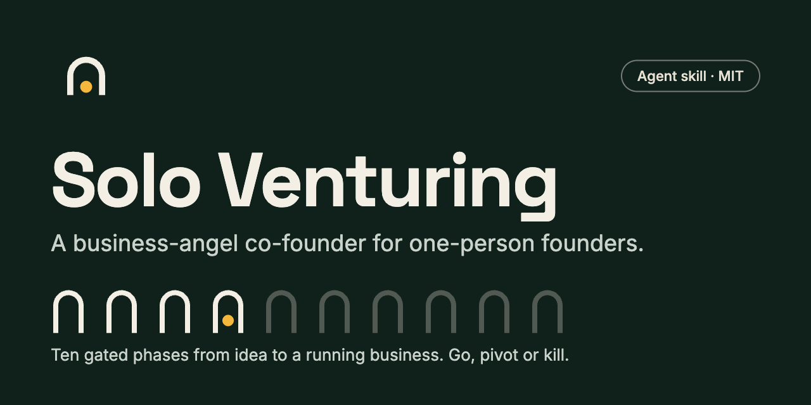

<p align="center">
  
</p>

# Solo Venturing

**A personal shark tank for your app idea.**

[](https://skills.sh/michael-ilic/solo-venturing)
[](LICENSE)
[](https://agentskills.io)

Pitch the idea. Get hard questions, a number to hit and a straight verdict.
Solo Venturing is an agent skill that works as your personal business angel:
it coaches you from the first sentence of an idea to a live app that earns
money, and it holds you to proof at every step.

Most AI agents hear an app idea, call it great and start writing code. This
one asks who has the problem, what you will accept as evidence, and what
result would make you stop. If the answer is "I'm out", you hear it after a
week of interviews, when it has cost you a few conversations and no code.

Every phase ends in a verdict against a bar you set in advance: **Go, Pivot,
Kill or Park**. Pass, and you move one step closer to launch with the proof
in hand.

It is free, open source and takes no equity. It works for mobile apps, web
apps and SaaS, desktop apps, browser extensions and developer tools, in
Claude Code and any agent that reads `SKILL.md`.

## Install

As a Claude Code plugin:

```
/plugin install solo-venturing --marketplace michael-ilic/solo-venturing
```

<details>
<summary>Other ways to install</summary>

On Claude Code older than 2.1.275, add the marketplace first:

```
/plugin marketplace add michael-ilic/solo-venturing
/plugin install solo-venturing@solo-venturing
```

By hand: download the source from the latest release, then copy the folder
`skills/solo-venturing` into your agent's skills folder (`~/.claude/skills/`
for Claude Code).

</details>

The scripts need `bash` and `python3`. Nothing else is installed and nothing
is sent anywhere.

## Pitch your idea

Open your agent in an empty folder and make the pitch:

```
/solo-venturing A reminder app for hobby potters to log glaze recipes
```

It sets up five small files and opens with the two questions an investor
asks first: who has this problem, and what did they do the last time it
hurt. In
any later session, `/solo-venturing` on its own picks up where the venture
stands.

You do not have to call it by name. It loads when you talk about an app
idea, validation, an MVP, pricing or a launch, and whenever the folder holds
a `VENTURE.md`.

Already have a prototype or a live app? Say so. It checks what exists
against each gate and starts at the first one your evidence does not pass.

## What you get

- **An investor on your side who is hard on your idea.** It names the
  weakest assumption in every phase and argues from evidence. Every market
  size, competitor and price carries a source and a date, or is labelled an
  assumption.
- **A number to hit in every phase.** You set the bar before the test runs:
  six of ten interviewees, 3% signup from 300 visitors, four of five testers
  finishing the core task. The result is held against it, so a weak one
  cannot be talked up afterwards.
- **Tests before code.** The cheapest test that could fail comes first:
  interviews, a landing page, a pre-sale. No product code is written before
  validation passes.
- **One step at a time, all the way to revenue.** Ten phases from idea to a
  product that pays its way, including the parts developers tend to skip:
  a channel for the first 100 users, pricing, tax and legal questions, the
  weekly numbers. One skill, where you would otherwise stitch ten together.
- **It remembers the whole venture.** Five markdown files in your project
  hold the pitch, the evidence and every decision. A new session, or a
  different agent, reads them and continues at the right step.
- **You have the last word.** It recommends; you decide. Overrule it and it
  writes down its concern once, then builds what you chose.

## A yes-machine or a business angel

| Pitch your idea to a plain agent | Pitch it to Solo Venturing |
| --- | --- |
| It writes code the moment it hears the idea | No product code before validation passes. The first session is a conversation about the user, the problem and what would end the idea. |
| It agrees with you | It names the weakest assumption in every phase and holds results against the bar you set. |
| It quotes market numbers from nowhere | Each number has a source and a date, or the word "assumption" next to it. |
| The next session has forgotten everything | Five files hold the venture. A cold session reads them and carries on. |
| "One more feature" keeps pushing the release | Deferred work goes on a "Not building" list with the trigger that brings it back. |
| The app ships and then nothing | Phases 9 and 10 cover metrics, unit economics, obligations, operations and one growth lever per quarter. |

This repository's eval suite shows the first row. Told "let's go, start
building" about a water-reminder app, an agent without the skill scaffolded
an Xcode project. With the skill it asked who the app is for and pointed out
that the category is crowded. You can run the comparison yourself; see
[Evals](#evals).

## Go, Pivot, Kill, Park

Every phase ends at a gate, the moment your idea goes back in front of the
investor. A gate is a short, fixed review: what was the bar, what did the
evidence show, what is still unproven. Then one decision out of four.

| Decision | It means | Example | What happens next |
| --- | --- | --- | --- |
| **Go** | The evidence met the bar. | Eight of ten interviewees had the problem last month; you asked for six. | The venture moves to the next phase. |
| **Pivot** | Part of the idea holds and part does not. | The problem is real, but the landing page converted 0.4% against a bar of 3%: the segment or the channel is wrong. | You change the part that failed and go back to the earliest phase the change affects. |
| **Kill** | The bar was missed and no cheaper test is left that could pass. | A store policy forbids the core feature, or both retention and acquisition fail after launch. | The venture stops. The files keep what you learned. A live product gets a sunset plan for its users. |
| **Park** | Not disproven, but not now. | You cannot reach the segment yet, or the product pays for itself and does not deserve more of your hours. | The stage stays where it is, and the log records what remains so coming back is cheap. |

Four things keep a gate from turning into a formality:

1. **You set the bar before the evidence comes in.** "3% signup from 300
   visitors" is written down before the first visitor arrives, so a weak
   result cannot be talked up afterwards.
2. **Kill criteria are written in phase 1.** Three of them, measurable, each
   with a date. You decide what would end the venture while you can still
   think about it calmly.
3. **The decision is yours.** The skill gives a recommendation and its
   reason. If you overrule it, the override is recorded with the concern and
   your choice is carried out in full.
4. **A script enforces it.** `check.py` fails when the venture has moved to a
   new phase without a recorded decision behind it.

A Kill is the process working. It costs one phase and returns the months the
idea would have taken.

This is what a verdict looks like. The numbers come from the example venture
in `evals/`:

```
Gate 2: Validation
Bar: 6 of 10 interviewees searched for a past recipe last month; 3% signup from 300 visitors
Result: interviews 8 of 10; signup 0.4%, 2 of 487 (RESEARCH.md, 2026-10-31)
Kill criteria: 1 clear (8 of 10), 2 triggered (0.4% against 3%), 3 not yet due
Budget: 10 hours a week until the review on 2027-02-01; no spend recorded
Passed: the problem is real and frequent
Failed or unknown: reaching potters beyond the founder's own studio
Weakest assumption left: that the segment can be reached at all
Recommendation: Pivot, because the problem holds and the channel does not
```

## The ten phases

| # | Phase | What happens | Go when |
| --- | --- | --- | --- |
| 1 | Idea | The user, the problem, your edge, your budget of hours and money | A one-liner, one target segment and three dated kill criteria are written |
| 2 | Validation | The cheapest test that could fail: interviews, a landing page, a pre-sale | The evidence meets the bar you set beforehand |
| 3 | Research and fit | Five competitors, positioning, pricing, bottom-up market sizing | The math reaches your 12-month target |
| 4 | Architecture | App type, stack, backend, payments, running costs | Decisions are made and a "Not building" list exists |
| 5 | Brand and marketing | A name you can own, the message, one channel | The name is cleared and the channel has a plan for the first 100 users |
| 6 | Prototype | The core task in front of five target users | Four of five complete it unaided |
| 7 | Build and internal test | The smallest version worth releasing, tested | The core loop works on a real device or browser, in testers' hands |
| 8 | Release and distribution | Seller setup, legal pages, listing, launch week | The checklist is green and the product can take money |
| 9 | Monitoring and iteration | Five metrics, a weekly review, a decision at six weeks | Users stay and revenue has a path to covering costs |
| 10 | Business | Unit economics, tax and legal questions, operations, growth | The product pays its way inside the hours you have |

One phase per session is the usual pace. Each phase does the smallest amount
of work that settles its gate, then stops.

## The five venture files

| File | Holds |
| --- | --- |
| `VENTURE.md` | The one-liner, target user, budget, stage, gate decisions, kill criteria, decisions with reasons, overrides, glossary |
| `RESEARCH.md` | Evidence with source and date |
| `LOG.md` | What happened and why, newest first, with the next action |
| `ERRORS.md` | Rules learned from corrections, so a mistake happens once |
| `CLAUDE.md` | Standing instructions for the agent on this venture |

They are plain markdown in your project folder. Commit them with your code.

## Works with your other skills

Solo Venturing runs the venture and leaves craft to the skills you already
have. In phase 7 your engineering skills own the build loop; your writing and
design skills are used for store copy and screens when they are installed.
None is required.

## Scripts

| Script | Does |
| --- | --- |
| `scripts/new_venture.sh <dir> "<name>"` | Scaffolds the five files. Refuses to overwrite. |
| `python3 -I scripts/check.py [dir]` | Validates the files. Fails when the stage has moved without a recorded gate decision. |
| `python3 -I scripts/context_budget.py` | Reads the Claude Code session transcript and reports context tokens (warns at 200k, stop at 250k). Reports "unknown" in other agents. |

`context_budget.py` reads token counts from the transcript files under
`~/.claude/projects/` for the current folder. It reads nothing else and makes
no network calls.

## Evals

Five cases in `evals/`, in the layout `claude plugin eval` reads. Each runs
with and without the skill and reports the difference.

| Case | Checks |
| --- | --- |
| `idea-asks-before-building` | "Just start building" leads to phase 1 questions, not code |
| `resume-venture-reads-files` | A cold session reads the files and continues at the recorded stage |
| `gate-honours-kill-criteria` | A missed bar is called out against the pre-set number, not explained away |
| `override-is-recorded` | An overruled recommendation is written down once and then built |
| `live-app-enters-business-phase` | A shipped app with revenue gets its numbers reviewed before new features |

```bash
claude plugin eval . --scaffold --allow-tools Write Edit Bash
```

Results land in `evals/results/`, which is git-ignored.

## Layout

```
.claude-plugin/          plugin.json, marketplace.json
skills/solo-venturing/
├── SKILL.md             the phases, the gates, how to ask, handoff
├── references/          one file per phase or pair of phases, read on demand
├── assets/              templates for the five venture files
└── scripts/             new_venture.sh, check.py, context_budget.py
evals/                   five cases with fixtures and graders
assets/                  icon and social preview
```

## Contributing

See [CONTRIBUTING.md](CONTRIBUTING.md). Reports of a session where the skill
gave bad advice are the most useful contribution: they become eval cases.

## License

[MIT](LICENSE)
